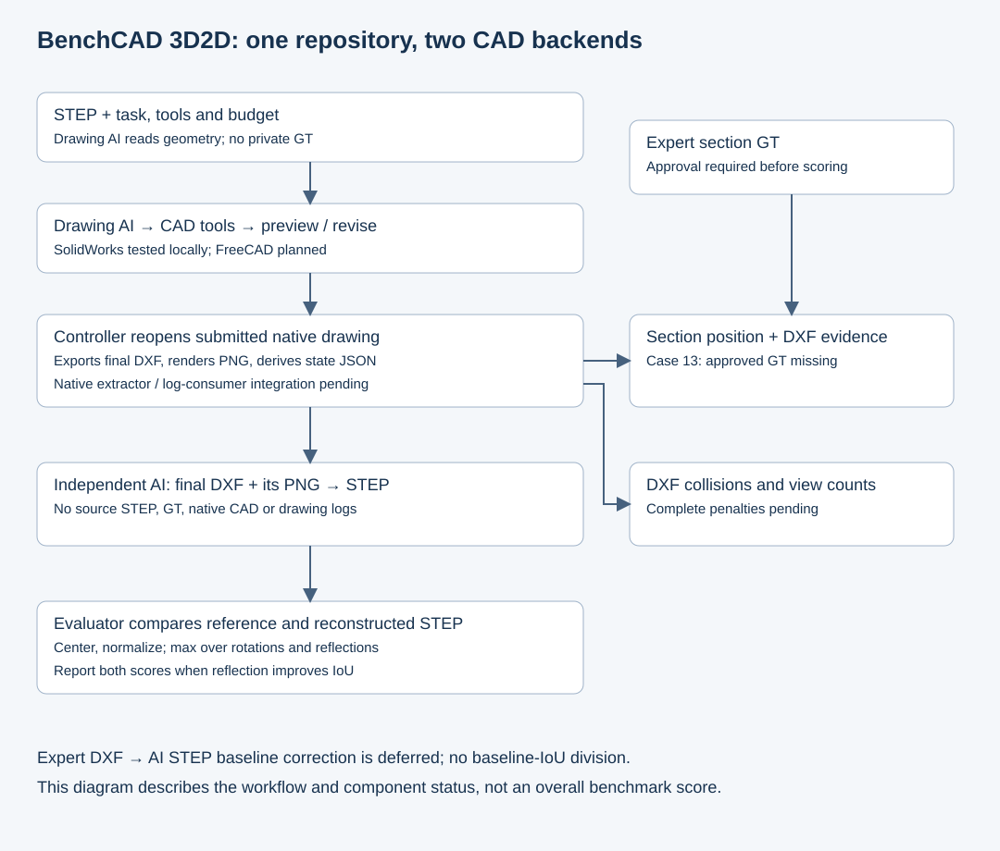

# BenchCAD 3D2D

**English** | [简体中文](README.zh-CN.md)

**One benchmark, two CAD backends: SolidWorks and FreeCAD.** An AI reads STEP and creates an engineering drawing. An independent AI reconstructs STEP from the final DXF and its rendered preview; the evaluator compares geometry and separately checks sections and drawing quality.

| Backend | Status | Start here |
|---|---|---|
| With SolidWorks | Local Windows + Codex CLI Case 13 pipeline completed; portable runner not yet published | [Backend](backends/solidworks/README.md) · [Detailed agent guide](docs/AGENT_SOLIDWORKS_CODEX.md) |
| With FreeCAD | Planned; no end-to-end benchmark run claimed | [Backend and acceptance checklist](backends/freecad/README.md) |

The backends share cases, task rules and evaluation policy, while keeping CAD tools, native formats and installation separate. Codex CLI is the agent runtime and can be used with either backend. Installing one backend does not require the other.

## Workflow and current decisions



In the local SolidWorks pilot, the drawing AI saves a native drawing and a submit marker. After CLI exit, the controller reopens the drawing, exports the final DXF, extracts actual view/section JSON, and renders the DXF to PNG. The reconstruction AI receives only that DXF, PNG and general instructions, with no source STEP, native CAD, GT, drawing logs or derived JSON.

- **No AI-authored section-score JSON:** use final CAD state / controlled operation records. The native extractor and public log-consumer interface are not yet integrated.
- **Geometry policy:** center and uniformly normalize each model, search 24 proper rotations and 24 reflected orientations, then use the higher IoU. Report both scores and a reflection flag only when reflection improves the score. Absolute-size diagnostics remain separate.
- **Expert baseline deferred:** do not reconstruct expert DXF for a baseline STEP and do not divide by expert reconstruction IoU.
- **No dimension-chain verifier in the active route.** Section evidence, full collision penalties, view-efficiency scoring and overall-score calibration remain incomplete.

## Local pilot evidence

Case 13 used SolidWorks 2023 and Codex CLI 0.163.0 with `gpt-6.1-sol / high`. Rotation-only IoU was **0.4848302861**; the selected reflected value is **0.9996046703**. The two effective AI stages took **34 min 3.5 s**, excluding setup and evaluation. This is a local pipeline trial, not a calibrated benchmark total or leaderboard result.

[Report](docs/experiments/case013-solidworks-codex.md) · [Portable result summary](docs/experiments/case013-summary.json) · [Known gaps](docs/STATUS.md)

## Repository structure

```text
cases/                    Existing source manifests and STEP/SLDPRT assets
backends/solidworks/      SolidWorks backend documentation and migration scope
backends/freecad/         FreeCAD backend plan and acceptance checklist
agents/codex_cli/         Agent interaction and CLI responsibilities
runner/                   Controller responsibilities (documentation)
evaluation/               Shared metric policy (documentation)
tools/                    Source checks and executable log-consumer interface
docs/                     Architecture, contracts, decisions and pilot report
```

Backend, agent, runner and evaluation directories currently contain documentation, not installable runtimes. The default source registry still has six T1 cases: **01, 13, 15, 84, 86, 88**, with sixteen archived CAD files. Selecting T1 01–10 for a later batch does not add or validate them here.

```bash
python tools/verify_sources.py
python -m unittest discover -s tests -v
```

These commands check source integrity and the synthetic log protocol. They do not run CAD, an AI model, geometry scoring or full sandbox validation.

## Documentation

- [Shared architecture and output layout](docs/ARCHITECTURE.md)
- [Input, output, feedback and submission](docs/INPUT_OUTPUT.md)
- [Evaluation design](docs/DESIGN.md) · [Confirmed decisions and PR disposition](docs/DECISIONS.md)
- [Operation-log interface](docs/OPERATION_LOG_DERIVATION.md)
- [Case source contract](docs/CASE_SPEC.md) · [Contributing](CONTRIBUTING.md)
- [Section annotation workbench](https://2d.cuptlab.site) — existing deployment; not revalidated or modified in this update

Historical [dimension-chain material](docs/RELATION_SEARCH.md) is retained for traceability. Repository organization references [BenchCAD 2 main](https://github.com/BenchCAD-org/benchcad-2-main); the mirror-inclusive normalized metric is explicitly a local 3D2D policy, not an unchanged upstream score.
