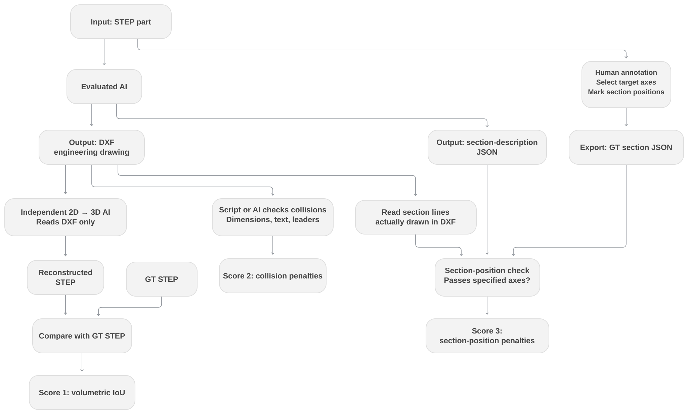

# BenchCAD 3D2D

**English** | [简体中文](README.zh-CN.md)

**Engineering drawings from STEP, evaluated through independent AI reconstruction and section checks.**

The evaluated AI receives a standardized STEP part and submits **only a DXF engineering drawing**. The controlled CAD environment records successful operations and final snapshots; an evaluator-side script derives the actual section JSON. The drawing must accurately communicate holes, steps, cavities, and other features, with appropriate section views. The current design replaces dimension-chain verification with independent AI reconstruction from DXF, followed by volumetric IoU against reference geometry. It also checks section positions relative to critical axes, annotation collisions, and redundant views.

**[Evaluation design](docs/DESIGN.md) · [Input/output contract](docs/INPUT_OUTPUT.md) · [Section annotation workbench](https://2d.cuptlab.site)**

The annotation workbench is available. Reconstruction calibration, evidence matching between the drawing and JSON, complete component reports, and the overall scoring rules still require integration or finalization. The full benchmark scoring pipeline is not yet ready.

## Evaluation workflow



*Proposed evaluation workflow; the complete scoring pipeline is not yet integrated.*

The independent reconstruction AI receives only the DXF and general instructions. It has no access to the original STEP, human ground truth (GT), operation logs, or derived JSON. The two AI roles have separate file-access boundaries. Section checks compare script-derived actual sections with human GT and independently check the DXF evidence. AI-authored claims are not trusted operation logs.

The [operation-log report and extension interface](docs/OPERATION_LOG_DERIVATION.md) provides a bounded JSONL reader, state reducer and CLI. Real CAD adapters, final-state capture, GT matching and DXF evidence checks remain pending. Parsing success is not a passing drawing score. See [issue #14](https://github.com/sunzhenchuan007/benchcad-3d2d/issues/14).

| Component | Evaluation target |
| --- | --- |
| Geometry recovery | Volumetric IoU between reconstructed and reference STEP solids, preserving absolute scale |
| Section quality | A longitudinal section contains a critical axis, or a transverse section passes through a specified axial position; angle constraints may be omitted |
| Drawing quality | Annotation collisions/occlusion and view redundancy in the actual DXF |

First, calibrate the reconstruction AI using trusted expert DXF drawings. Rewards for recommended sections, penalties for missing required sections, tolerances, and overall weights have not been finalized. The historical 40/35/20/5 weights do not apply to the current approach.

## Annotation workbench

[2d.cuptlab.site](https://2d.cuptlab.site) provides STEP previews, standard views, axis snapping and hover highlighting, section-position and optional angle annotation, and compact JSON import/export. It remembers the annotator's name in the same browser and offers a “Next case” button. A STEP-upload page and backend API are deployed.

The workbench hosts model pages for seven local cases. Case 84 has no detected selectable axes and currently supports model viewing only. Hosted cases and repository source registration are tracked separately. The workbench implementation and Case 11 experiment are not yet included in the repository's default branch.

## Repository contents and status

The default branch registers six T1 source cases: **01, 13, 15, 84, 86, and 88**, containing sixteen STEP/SLDPRT source files with their original version paths and provenance. Source integrity checks are available; see [STATUS.md](docs/STATUS.md) for scoring readiness.

```text
cases/<case_id>/
├── case.json          # Source manifest, hashes, and readiness status
└── sources/           # Original STEP/SLDPRT versions

docs/
├── DESIGN.md          # Current evaluation design
├── INPUT_OUTPUT.md    # Proposed input, GT, submission, and verifier boundaries
├── CASE_SPEC.md       # Existing source-registration contract
└── STATUS.md          # Implementation status and next steps
```

```bash
python tools/verify_sources.py
```

This command checks paths, formats, sizes, SHA-256 hashes, and registry consistency. It does not run AI reconstruction, validate drawings, or calculate model scores.

## Further reading

- [Operation-log interface and GT compatibility](docs/OPERATION_LOG_DERIVATION.md)
- [Case specification](docs/CASE_SPEC.md)
- [Contributing](CONTRIBUTING.md)
- [Source review guide](docs/REVIEWING.md)
- [Historical dimension-chain algorithms](docs/RELATION_SEARCH.md)
- [Historical dimension-chain JSON examples](examples/dimension_chain/README.md)

Historical dimension-chain materials remain for research and traceability; they are not required by the current evaluation approach. Repository organization draws on [BenchCAD 2 main](https://github.com/BenchCAD-org/benchcad-2-main). The new 3D-to-2D evaluation still needs independent calibration.
