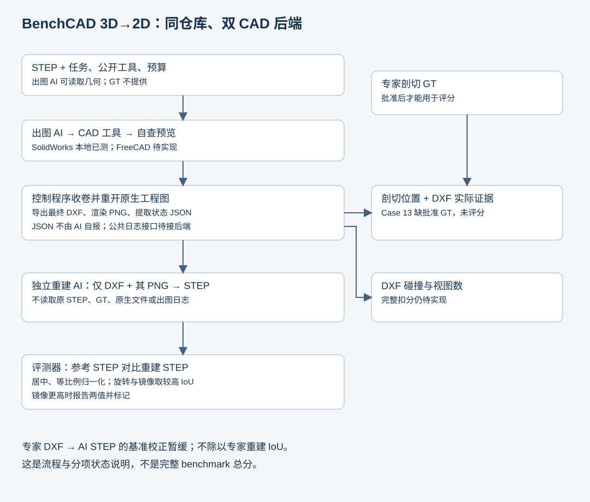

# BenchCAD 3D2D

[English](README.md) | **简体中文**

**一个 benchmark，SolidWorks 和 FreeCAD 两个 CAD 后端。** 出图 AI 读取 STEP、制作工程图；独立重建 AI 根据最终 DXF 和其预览恢复 STEP，评测器比较几何，并分别检查剖切和图纸质量。

| 版本 | 当前状态 | 从这里开始 |
|---|---|---|
| With SolidWorks | Windows＋Codex CLI 的 Case 13 本地流程已跑通；可移植运行代码尚未发布 | [后端说明](backends/solidworks/README.md) · [AI 如何工作](docs/AGENT_SOLIDWORKS_CODEX.md) |
| With FreeCAD | 待实现，尚无本项目端到端试验结果 | [后端方案与验收清单](backends/freecad/README.md) |

两套后端共享案例、任务规则和指标，各自维护 CAD 工具、原生格式和安装环境。Codex CLI 是 Agent 运行系统，可以分别使用两套 CAD；使用一套后端不要求安装另一套。

## 当前流程与决定



SolidWorks 本地试验中，出图 AI 保存原生工程图并写提交标记。CLI 结束后，控制程序重开原生图纸，导出最终 DXF、提取实际视图／剖切 JSON，再渲染 DXF 为 PNG。重建 AI 只接收最终 DXF、该 PNG 和通用说明，不能读取原 STEP、原生 CAD、GT、出图日志或派生 JSON。

- **剖切评分 JSON 由程序派生**，不由 AI 自报。本地原生状态提取器与仓库公共日志接口尚未接通。
- **IoU 规则**：各自居中和等比例归一化，搜索 24 个旋转，再镜像搜索 24 个旋转，采用较高值。镜像严格更高时同时报告两值并标记；绝对尺寸诊断另列。
- **专家校正暂缓**：不做专家 DXF 的 AI 重建 STEP，也不除以专家重建 IoU。
- **不使用尺寸链验证主流程**。剖切证据匹配、完整碰撞扣分、视图冗余和总分校准仍待完成。

## 本地试验结果

Case 13 使用 SolidWorks 2023、Codex CLI 0.163.0 和 `gpt-6.1-sol / high`。仅旋转 IoU 为 **0.4848302861**，当前采用镜像后的 **0.9996046703**。两次有效 AI 阶段合计 **34 分 3.5 秒**，不含环境准备和评测时间。这是本地流程试验，不是完整 benchmark 总分或排行榜成绩。

[试验报告](docs/experiments/case013-solidworks-codex.md) · [结果摘要 JSON](docs/experiments/case013-summary.json) · [实现缺口](docs/STATUS.md)

## 文件组织

```text
cases/                    已登记的源清单与 STEP/SLDPRT 文件
backends/solidworks/      SolidWorks 后端说明与迁移范围
backends/freecad/         FreeCAD 后端方案与验收清单
agents/codex_cli/         Agent 交互与 CLI 职责
runner/                   控制程序职责说明
evaluation/               公共指标政策说明
tools/                    可执行的源校验、日志消费者接口
docs/                     架构、协议、决定与试验报告
```

后端、Agent、runner 和 evaluation 目录当前提供文档，不是已安装可运行的软件包。源注册表仍为六例 **01、13、15、84、86、88**，共十六份 CAD 文件。另选 T1 01–10 作为后续批次，不等于本次已导入或跑完十例。

```bash
python tools/verify_sources.py
python -m unittest discover -s tests -v
```

这些命令检查源文件完整性和合成日志协议，不运行 CAD 或 AI，不计算几何分数，也不证明完整隔离。

## 阅读入口

- [公共架构与运行产物目录](docs/ARCHITECTURE.md)
- [输入、输出、反馈与提交](docs/INPUT_OUTPUT.md)
- [评测方案](docs/DESIGN.md) · [已确认决定与 PR 整理](docs/DECISIONS.md)
- [操作日志派生接口](docs/OPERATION_LOG_DERIVATION.md)
- [源案例合同](docs/CASE_SPEC.md) · [贡献说明](CONTRIBUTING.md)
- [剖切标注工作台](https://2d.cuptlab.site)：已有部署，本次未检查在线状态或修改部署

历史[尺寸链材料](docs/RELATION_SEARCH.md)保留供追溯。仓库组织参考 [BenchCAD 2 main](https://github.com/BenchCAD-org/benchcad-2-main)；归一化并允许镜像的指标明确属于本地 3D2D 政策，不冒充未修改的上游指标。
