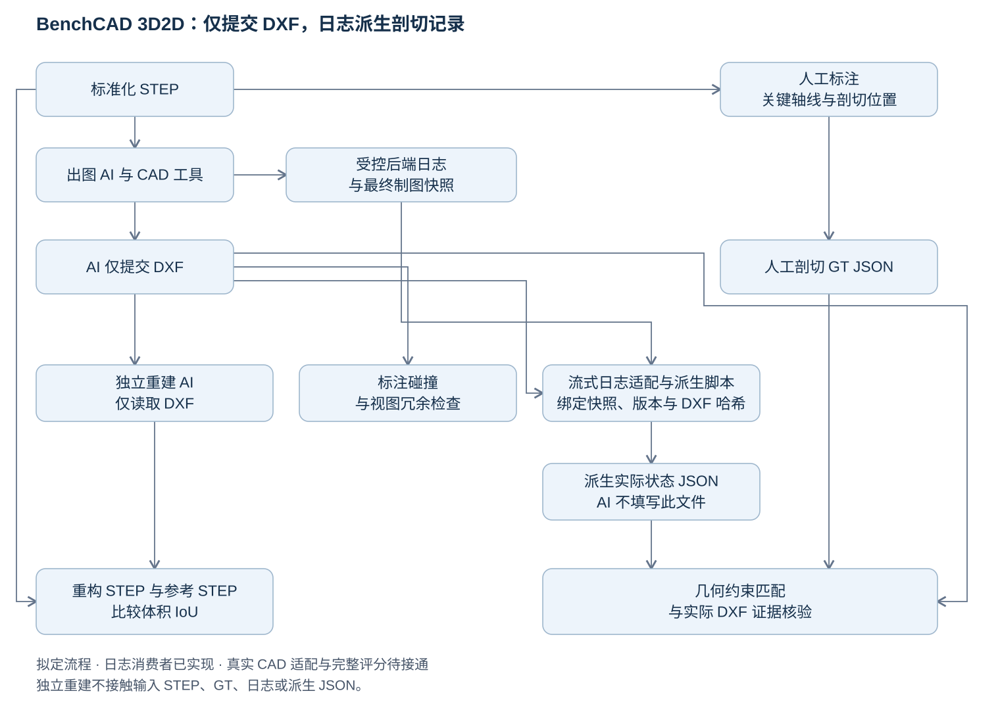

# BenchCAD 3D2D

[English](README.md) | **简体中文**

**从 STEP 生成工程图，通过独立 AI 重构和剖切检查进行评测。**

被评测 AI 输入标准化 STEP 零件，**仅提交 DXF 工程图**。受控 CAD 环境记录成功操作与最终快照，由评测端脚本派生实际剖切 JSON。图纸需要准确表达孔、台阶、腔体等特征以及必要的专业剖视。当前方案放弃尺寸链验证，采用独立 AI 仅根据 DXF 重构 STEP，再与参考几何比较体积 IoU；同时检查关键轴线的剖切位置、DXF 标注碰撞和视图冗余。

**[当前方案](docs/DESIGN.md) · [输入输出约定](docs/INPUT_OUTPUT.md) · [剖切标注工作台](https://2d.cuptlab.site)**

标注工作台已可用。AI 重构校准、图纸与 JSON 的证据匹配、完整分项报告和总分规则仍待接通或冻结，完整的 benchmark 评分流程尚未就绪。

## 评测流程



*当前拟定评测流程，完整评分链路尚未接通。*

独立验证 AI 的输入仅为 DXF 与通用说明，原 STEP、人工真值（GT）、操作日志和派生 JSON 不挂载给它。两个 AI 的角色和文件访问边界分开。剖切检查将脚本派生的实际状态与人工要求匹配，同时核验实际 DXF 证据；AI 自述不能代替可信操作记录。

[日志派生报告与开放接口](docs/OPERATION_LOG_DERIVATION.md)提供可运行的流式 JSONL 读取、状态归约和 CLI。真实 CAD 后端适配、最终快照采集、GT 匹配与 DXF 证据检查仍待接入，解析成功不表示图纸评分通过。跟踪见 [issue #14](https://github.com/sunzhenchuan007/benchcad-3d2d/issues/14)。

| 分项 | 评价内容 |
| --- | --- |
| 几何恢复 | 重构 STEP 与参考 STEP 的体积 IoU，保留真实尺度 |
| 专业剖切 | 沿轴剖包含关键轴，或横切经过规定轴向位置；角度可不作要求 |
| 图纸质量 | 实际 DXF 的标注碰撞／遮挡和视图冗余 |

先用专家 DXF 校准验证 AI 的重构可靠性。推荐剖切奖励、必要剖切缺失扣分、容差和总分权重尚未冻结；旧 40/35/20/5 权重不用于当前路线。

## 标注工作台

[2d.cuptlab.site](https://2d.cuptlab.site) 提供 STEP 预览、标准视角、轴线吸附高亮、剖切位置与可选角度标注，以及精简 JSON 导入／导出。姓名在同一浏览器内记忆，可通过“下一个 case”连续标注；上传新 STEP 的网页入口和后台接口已上线。

工作台包含本地七个案例的模型页面，其中 Case 84 未识别到可选轴线，当前仅支持查看模型。网页部署和仓库源案例注册分别记录。网页实现及 Case 11 的实验材料尚未纳入仓库默认分支。

## 仓库内容和状态

当前主分支登记六个 T1 源案例：**01、13、15、84、86、88**，共十六份 STEP／SLDPRT 源文件，保持原版本路径和来源记录。源文件完整性校验已提供；正式评分就绪状态见 [STATUS.md](docs/STATUS.md)。

```text
cases/<case_id>/
├── case.json          # 源文件清单、哈希和就绪状态
└── sources/           # 原 STEP/SLDPRT 版本

docs/
├── DESIGN.md          # 当前评测方案
├── INPUT_OUTPUT.md    # 待冻结的输入、GT、提交和验证边界
├── CASE_SPEC.md       # 已有源数据注册合同
└── STATUS.md          # 实现状态及下一步
```

```bash
python tools/verify_sources.py
```

该命令检查路径、格式、大小、SHA-256 和注册清单一致性，不运行 AI 重构、不验证图纸或计算模型分数。

## 进一步阅读

- [日志派生接口与 GT 兼容报告](docs/OPERATION_LOG_DERIVATION.md)
- [案例合同](docs/CASE_SPEC.md)
- [贡献指南](CONTRIBUTING.md)
- [源数据复核说明](docs/REVIEWING.md)
- [历史尺寸链算法](docs/RELATION_SEARCH.md)
- [历史尺寸链 JSON 示例](examples/dimension_chain/README.md)

历史尺寸链材料保留供研究和追溯，不作为当前评测路线的必需步骤。仓库组织参考 [BenchCAD 2 main](https://github.com/BenchCAD-org/benchcad-2-main)；新的三维到二维评测仍需独立校准。
