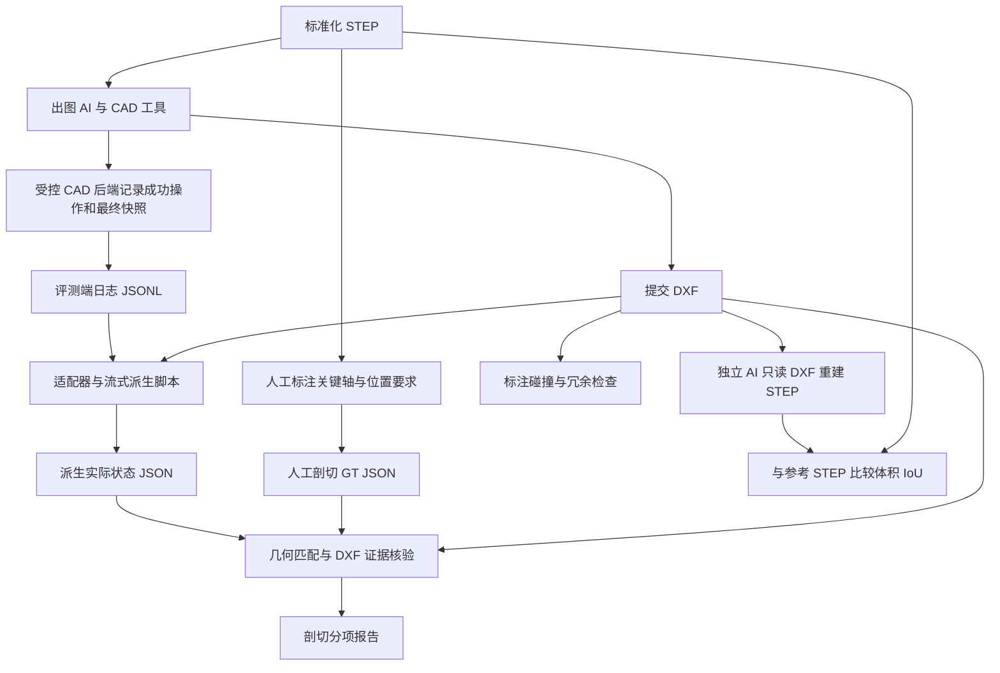

# 从操作日志派生剖切 JSON：设计报告与开放接口

关联 [issue #14](https://github.com/sunzhenchuan007/benchcad-3d2d/issues/14)。这是首版可测试接口，不是完整 CAD 日志识别器或评分器。

## 与当前本地试验的关系

更新说明（2026-10-16）：本页描述公共日志消费者。SolidWorks 本地试验实际要求 AI 保存原生工程图，由控制程序重开并生成最终 DXF、PNG 和 JSON；它直接读取原生状态，尚未接入本页 EventAdapter。重建 AI 还接收最终 DXF 渲染的 PNG。下方 DXF-only 指二维评测产物，不表示当前 SolidWorks 收卷只接受裸 DXF。专家 DXF 重建校正暂缓，IoU 使用归一化旋转／镜像最大值，见 [当前设计](DESIGN.md)。

## 流程变更

AI 的正式制图提交只有 `drawing.dxf`。AI 不再自行撰写用于剖切评分的 JSON。评测环境在 CAD 工具执行时记录结果，后台脚本从日志派生实际视图与剖切记录，再与人工 GT 做几何约束匹配。



这里的记录是 CAD 后端记录，不是聊天中的“我已经剖切”或模型打算执行的代码。只截取调用文本无法证明调用成功，也无法知道视图后来是否被删除。

## 可信边界与 DXF 一致性

控制程序应在 Agent 无写权限的目录保存日志。CAD 后端在操作成功后输出参数、文档版本、稳定视图 ID；导出时读取最终 CAD 状态，并记录导出 DXF 的 SHA-256。STEP 哈希、run ID 和 case ID 由控制程序另行提供给派生脚本核对。

建议顺序：操作 → 后端成功结果 → 最终状态快照 → 导出 DXF → 绑定导出编号并提交。快照和导出必须对应同一文档版本。后续修改只影响新版本，不能改变已提交 DXF 的剖切记录。

日志中写 `trusted: true` 不会自动获得可信性。实际权限隔离、日志不可篡改、快照完整性和后端对所有制图入口的覆盖，需要控制程序落实。本 PR 只提供消费者接口，没有实现这些环境保证。

若 AI 直接改 DXF，哈希变化能发现它与已记录导出不一致；但未受控的导出器或不完整快照仍可能给出错误语义。哈希不能证明视图正确，实际 DXF 的剖视、剖切线、箭头与标识仍需独立检查。

## 已实现的接口

入口：[tools/operation_log_manifest.py](../tools/operation_log_manifest.py)，仅使用 Python 标准库。

| 接口 | 职责 |
| --- | --- |
| `EventAdapter.events(stream, limits)` | 扩展接口，输出规范事件；真实 CAD／Python 后端适配器待接入 |
| `NormalizedJSONLAdapter` | 逐行读取已经规范化的 JSONL；不解析任意原始聊天文本 |
| `derive(events, run_id=..., case_id=..., input_sha256=..., dxf_sha256=...)` | 校验身份、顺序、成功状态，维护视图状态并绑定最终导出 |
| CLI | 读取日志、计算提交 DXF 哈希、写派生 JSON，并提供资源上限参数 |

调用示意（路径与标识由控制程序填写）：

```bash
python tools/operation_log_manifest.py /evaluator/events.jsonl \
  --dxf /submission/drawing.dxf --output /evaluator/actual_sections.json \
  --run-id RUN_ID --case-id CASE_ID --input-sha256 INPUT_STEP_SHA256
```

退出码：`0` 表示派生成功且必要引用齐全；`2` 表示已输出 JSON，但缺少最终快照、视图或必要 DXF 引用；`1` 表示输入错误、不支持的操作／剖视、身份不符、超预算或文件错误。`0` 不表示 DXF 几何或 GT 检查通过。

CLI 在同一次日志扫描中计算原始日志 SHA-256，并写入输出的 `source.operation_log_sha256`。每次运行使用新的输出路径；CLI 拒绝覆盖已有文件，避免把旧运行产物混入新结果。控制程序只应在检查本次退出码后读取本次输出；文件 I/O 中断产生的不完整文件不应使用。DXF 和日志应在派生期间保持不可修改。

CAD 后端开发者实现 `EventAdapter`，将成功返回值和状态查询结果转换为以下事件，交给 `derive`。适配器需流式处理并落实原始输入字节限制，不能让 AI 自己标记调用成功。

## 规范日志 v1

每行一个 UTF-8 JSON 对象。共同字段为 `run_id`、严格递增的非负整数 `seq`、`kind` 和布尔型 `success`。文档版本是后端维护的非负递增整数，不能由模型任意填写。首次事件必须是成功的 `run_started`。v1 每个 run 对应一个制图文档；多文档后端需先选定提交文档，不能混合不同文档的同名视图。

| `kind` | 额外字段与语义 |
| --- | --- |
| `run_started` | `schema_version: benchcad-cad-events/1`、`case_id`、`input_sha256`、`units: mm`、`frame: input_step` |
| `view_upsert` | `document_revision`、`view`；成功新增／修改视图，版本必须前进 |
| `view_delete` | `document_revision`、`view_id`；成功删除已知视图，版本必须前进 |
| `drawing_snapshot` | `document_revision`、`views`；后端查询到的完整当前视图集合，替换状态；用于最终状态、撤销与重做 |
| `dxf_export` | `document_revision`、`export_id`、`dxf_sha256`；导出当前版本，冻结此刻视图状态 |
| `submission_finalized` | `export_id`；选定最近一次成功导出，哈希必须匹配提交 DXF |
| `telemetry` | 可忽略的非几何记录；图片、STEP、视频使用外部文件引用，不放 base64 |

失败操作不改变状态；未知类型拒绝处理，避免把未知操作误当成无关文本。最终提交后只允许 telemetry。为保持内存有界，v1 仅保留最近一次成功导出；若要提交更早版本，应重新导出该版本。

视图示例（合成对象，不对应真实 case 或 GT）：

```json
{
  "id": "view-A",
  "kind": "section",
  "section": {
    "type": "full",
    "plane": {"point_mm": [0, 0, 30], "normal": [0, 0, 1]}
  },
  "dxf_evidence": {
    "view_handles": ["A1"],
    "cutting_line_handles": ["B1"],
    "label_handles": ["C1"]
  }
}
```

平面参数在固定输入 STEP 坐标中，以毫米表示；法向必须是单位向量。普通视图为 `kind: projection`，不带 `section`。DXF handle 仅定位本次图纸，不与专家 handle 比较；是否存在且表达正确由后续核验负责。

v1 只支持普通投影和单平面全剖。半剖、阶梯剖、旋转剖、局部剖、投影坐标映射及切除区域需要版本化扩展；遇到声明但不支持的剖视类型会报错。不能把两张普通图自动当成半剖，也不能用一个平面冒充复杂剖切。

输出 `benchcad-derived-drawing/1` 包含输入身份、单位／坐标、导出编号／版本／哈希／事件序号、视图列表、信息缺项与事件数。`evidence_status` 固定为 `not_checked`，`scoring_status` 固定为 `not_scored`。它描述事实候选，不能替代 GT 或专业检查。

## 长日志的成本

会有开销，但规范日志无需逐句调用模型。脚本使用 JSON 解析和状态更新，不需要向量索引、全文搜索或重放全部 CAD 操作。

- 读取解析约为 O(B)，B 为日志字节数；输出排序另需 O(V log V)，V 为视图数。
- 内存保留当前状态和最近导出，不保留全部历史；还需容纳一行 JSON／最终快照。默认单行上限 8 MiB。
- DXF 扫描一次计算哈希，额外 O(D)，不会逐事件重新渲染或加载 STEP。
- 默认总日志上限 1 GiB、事件上限 200 万、活动视图上限 1 万，可用 CLI 调整。这些是保护默认值，不是校准后的竞赛预算。
- 图片／模型／视频作为外部文件，不在日志嵌入大块二进制。

原始日志若没有结构化参数和成功状态，成本与可靠性不同，不能因“都是文本”就保证免费或正确。CAD 几何检查、渲染和 DXF 重建应另行限时限内存。增量检查点、压缩和断点恢复暂未实现。合成性能结果只代表本消费者，不代表真实 CAD 后端。

### 合成性能检查

复现命令：`python tools/benchmark_operation_log.py`。本次本机 Windows、Python 3.11.5；每 100 条中一条更新视图，其余为 telemetry，最终保留 10 个视图。表内字节为实际 UTF-8 JSONL 大小，事件数包含开始／快照／导出／提交事件。

| 事件数 | 日志字节 | 用时（秒） | Python 分配峰值（MiB） |
| ---: | ---: | ---: | ---: |
| 10,004 | 1,123,901 | 0.183 | 0.080 |
| 100,004 | 11,313,708 | 1.721 | 0.056 |
| 500,004 | 57,005,708 | 8.928 | 0.054 |

计时包含读取、JSON 解析、日志哈希、状态归约与 tracemalloc 的开销，不包含日志生成、DXF 哈希扫描、渲染或 CAD。分配峰值仅为 tracemalloc 跟踪到的 Python 增量分配，**不是进程总内存或容器内存**；较早一次测试还包含初始化分配。状态更多或快照更大时，内存也会增加，仍应在容器中设置硬限制。这里没有 LLM token 消耗，但有 CPU、磁盘与存储成本。

## 现有 GT 是否够用

**轴线与位置约束可以复用；GT 与派生 JSON 不能逐字段比较；现有草稿还不是完整评分 GT。**

本次检查发现公开文档此前描述 `benchcad-section-position-draft/3`；本地实验网页 `draft.js` 已用 `/5`，能读取 `/3`、`/4`、`/5`。这些本地代码与私有标注未随本 PR 发布，本次也未验证线上部署版本。

| 已有字段／能力 | 新路线处理 |
| --- | --- |
| STEP 哈希、mm、稳定轴引用和几何 | 复用，确保同一模型与坐标 |
| `contains_axis` | 复用：实际切面包含轴，不能只相交一点 |
| `crosses_axis_at_station` | 复用：横切交点位于规定站位与容差 |
| `angle_rule` | 复用：可不要求角度；仍检查位置 |
| 本地 v5 `contains_lines` | 本消费者未实现 GT 匹配，需明确两线约束和复杂剖切范围 |
| 本地 v5 `required`、`optional`、`one_of` | 保留已有语义；`optional` 不自动等于“满足就奖励” |
| 本地 v5 必选组、参考方案、视图分类 | matcher 应支持整体备选方案，不能混取不同方案的最小视图数 |
| `status: draft`、标注人等 | 供追溯，仍需人工验收与正式版本迁移 |

GT 描述“应满足哪些关系”，派生 JSON 描述“实际画了哪些剖面”。多个切面和布局可以合法满足同一目标，不应强制复制专家画法。

正式评分前仍需固定坐标与容差、验收 GT、实现 v3/v4/v5 迁移／校验、定义必要／可选／奖励／备选组及复杂剖视规则，并接通 matcher 与 DXF 证据。日志、run、DXF 哈希属于每次运行的派生记录，无需复制进每条 GT。参考轴索引的版本与完整几何应保留。

## 验收范围与后续

合成测试覆盖增删改、失败、撤销快照、导出后编辑、哈希不符、跨 run、顺序错误、无效平面、不支持剖视、预算与 CLI。没有运行真实 CAD 适配、几何重建或模型评分。

1. 选择首个 CAD 后端，落实日志写权限与最终快照，覆盖全部制图入口。
2. 用真实导出检查日志／快照／DXF 一致性，接通证据核验。
3. 扩展复杂剖视并迁移、验收 GT。
4. 接通 matcher、碰撞及独立重建，在专家 DXF 上校准后冻结评分。

源案例与注册状态不变。未发布专家 DXF、私有 GT、Case 11 实验或服务器凭据。
